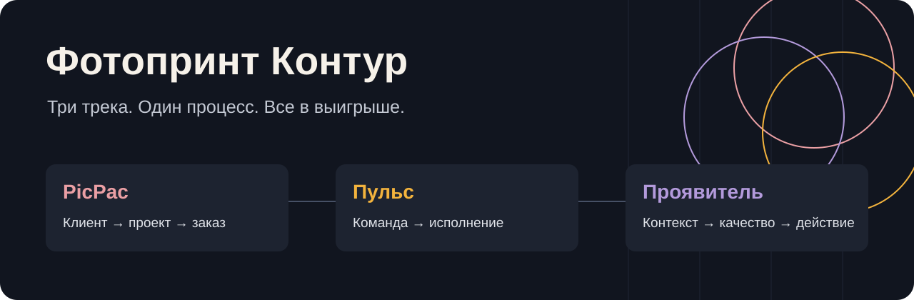
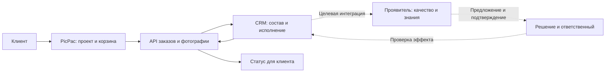

**[GitHub проекта](https://github.com/Danikcreat/proyavitel-ai)**

<div align="center">



  


# Фотопринт Контур

### Три трека. Один процесс. Все в выигрыше.

**«Пульс» — управление бизнесом · PicPac — приложение для клиента · «Проявитель» — AI-ассистент**

От первой идеи фотокниги до выполненного заказа и решения, которое улучшает следующий.

[Попробовать PicPac](https://picpac.vercel.app/) · [Показать сквозное демо](#демо-которое-связывает-три-трека) · [Архитектура](#как-это-устроено) · [Запуск](#запуск)

**Хакатон Фотопринт · Демонстрационный MVP · Треки 1, 2 и 3**

</div>

---

## Один заказ — общая ответственность

Клиенту нужна красивая фотокнига, которую легко создать и приятно получить вовремя. Команде — понятная очередь работы. Руководителю — возможность увидеть отклонение, разобраться в нём и довести решение до результата.

**Мы объединяем эти потребности в одну экосистему.** PicPac помогает клиенту дойти до заказа. «Пульс» превращает заказ в управляемую работу. «Проявитель» помогает разобраться в качестве и выбрать следующее действие.

Наш главный результат — три подготовленных трека и работающий локальный сценарий передачи заказа из приложения в раздел CRM. Единый контур ролей, производственных интеграций и AI-аналитики развиваем вокруг этого сценария; ниже разделены работающие возможности, демонстрационные экраны и следующий этап интеграции.

> **Удобнее оформить → проще выполнить → раньше заметить проблему → меньше переделок → качественный продукт → больше доверия и поводов вернуться.**

Последние звенья — бизнес-гипотеза для пилота. Мы показываем механизм её достижения, а не выдаём прогноз за измеренный результат.

## Три трека в одной системе

| Трек | Продукт | Для кого | Главная ценность |
|---|---|---|---|
| **1. CRM и управленческая платформа** | **«Пульс»** | Директор, руководители функций, сотрудники | Общая картина бизнеса и рабочее место по своей зоне ответственности |
| **2. Мобильный клиентский интерфейс** | **PicPac** | Покупатель фотокниг и фотопечати | Понятный путь от вдохновения и фотографий до номера заказа |
| **3. AI-ассистент** | **«Проявитель»** | Руководитель и операционная команда | Анализ качества, работа с контекстом и знаниями, подготовка действий с подтверждением |

Мобильный трек реализован как адаптированное веб-приложение с мобильным интерфейсом и service worker. Нативная публикация в App Store и Google Play не входит в текущий MVP.

## Все в выигрыше — по конкретной причине

| Участник | Что меняется | На что рассчитываем в пилоте |
|---|---|---|
| **Клиент** | Меньше сложных переходов, сохранённый черновик, понятные предупреждения о качестве и статус заказа | Больше завершённых покупок и доверия к результату |
| **Сотрудник** | Нужный контекст, приоритет и зона ответственности вместо потока несвязанных задач | Меньше переключений и повторного поиска информации |
| **Руководитель функции** | Отклонения своего направления и основания для решения | Быстрее разбор проблемы и согласование действий |
| **Директор** | Связь клиентского заказа, исполнения и показателей качества | Меньше ручной сборки общей картины |
| **Бизнес / работодатель** | Прослеживаемый процесс и решения, эффект которых можно проверить | Меньше перепечаток, потерь материалов и времени; больше повторных покупок |

**Человеческий фактор — часть архитектуры.** Принцип рабочих мест: показывать человеку то, что связано с его задачами и полномочиями. Это направлено на снижение когнитивной нагрузки. Мы не заявляем доказанного медицинского эффекта и не сводим оценку сотрудника к одному показателю брака.

---

## Трек 1 · «Пульс»: бизнес в одном рабочем контуре

«Пульс» задуман как общая точка работы с заказами, показателями, ответственными и решениями. Руководителю не нужно вручную собирать контекст из нескольких несвязанных экранов, чтобы понять, где требуется вмешательство.

**«В одном месте» означает единый доступ к связанным данным и действиям.** Реальные ERP, CRM, 1С и каналы коммуникаций могут сохранять собственные хранилища: платформа объединяет их через API и адаптеры, а не требует заменить всё сразу.

### Три пространства работы

| Пространство | Главный вопрос | Состав продуктовой архитектуры |
|---|---|---|
| **Пульс** — аналитика и управление | «Где отклонение и что с ним делать?» | KPI, детализация причин, реестр решений, проверка эффекта, качество данных |
| **Цех** — операционная работа | «Что требует действия сейчас?» | Заказы, модерация, этапы производства, поддержка, задачи, оборудование и материалы |
| **Люди и деньги** | «Хватит ли ресурсов и какой результат получает бизнес?» | Команда и нагрузка, финансы, база знаний, подбор и согласования |

Это карта платформы. Наличие модуля в архитектуре не означает завершённую интеграцию его с реальной системой предприятия.

### Главное отличие: сигнал должен закончиться действием

```text
Отклонение показателя
        ↓
Детализация: период, участок, станок, доступные факты
        ↓
Решение: что проверить, кто отвечает, к какому сроку
        ↓
Выполнение
        ↓
Повторное измерение: стало лучше или требуется другое действие?
```

Ценность — в сохранении связи между проблемой, ответственностью и результатом. График становится началом работы, а не её последним шагом.

### Каждому — своё рабочее место

- **Директор:** общий обзор, межфункциональные отклонения, приоритеты и результат решений.
- **Руководитель направления:** показатели и задачи своего подразделения, объяснение отклонений и исполнители.
- **Оператор:** очередь заказов, этап, требование к качеству и следующее действие.
- **Поддержка:** заказ и обращение в одном контексте.
- **HR и финансы:** профильные данные в пределах разрешённого доступа.

Целевая модель — **роль + область данных подразделения**, с серверной проверкой прав. В локальном демонстрационном разделе заказов вход отключён специально для показа; это отдельный режим, а не доказательство работы ролевого разграничения всей платформы.

### Что уже связывает PicPac и CRM

Подтверждённый заказ появляется в локальном разделе CRM с:

- составом корзины, количеством, параметрами продукта и рассчитанными суммами;
- получателем, способом получения и адресом;
- настройками макета и сохранённым планом альбома;
- исходными JPEG/PNG, отправленными при оформлении;
- полным исходным запросом и статусом заказа.

Повторная отправка с тем же ключом не создаёт второй заказ. Изменённый в CRM статус доступен клиенту через API истории заказов. Данные и фотографии сохраняются на компьютере между перезапусками.

**Это наблюдаемость жизненного цикла заказа.** Полная аналитика каждого клика клиента, CRM-воронка поведения и сквозной аудит всех трёх сервисов — следующий этап, а не уже реализованное тотальное отслеживание.

## Трек 2 · PicPac: хочется создать — удобно закончить

Мы начинаем с клиентского опыта: чтобы приложение помогало сохранить воспоминания, а не заставляло разбираться в интерфейсе.

### Вдохновение до покупки

Главная построена как лента: идеи, отзывы, новые шаблоны и акции. Пользователь может сначала найти повод для фотокниги, затем выбрать подходящий дизайн и перейти к созданию.

Это **социальный формат ленты**, а не готовая социальная сеть. Публичные пользовательские публикации, подписки, совместные альбомы и персональные рекомендации остаются направлениями развития.

### Полный клиентский путь

1. **Войти или продолжить гостем.** Контактные данные понадобятся перед подтверждением заказа.
2. **Выбрать продукт.** Каталог, шаблон, формат, тариф, страницы, цена и ориентировочный срок.
3. **Добавить фотографии.** JPEG/PNG с устройства или учебные изображения из галереи; понятные ограничения размера.
4. **Собрать альбом.** Изменить порядок снимков, размещение, подписи и фон. Черновик сохраняется локально.
5. **Проверить качество.** Увидеть пустые области, отсутствующие файлы, неподдерживаемый формат и предупреждения о разрешении.
6. **Оформить корзину.** Количество, тестовый промокод, получение и пересчёт итоговой суммы.
7. **Получить номер заказа.** Подтверждение без реального списания денег; при потере связи запрос сохраняется в очередь.
8. **Следить за исполнением.** История, состав, суммы, статусная лента и обращение, связанное с конкретным заказом.

### Как работает проверка фотографий

До заказа приложение проверяет доступность файлов, формат, заполнение проекта и достаточность разрешения для печати. По размерам изображения и печатному формату рассчитывается ориентировочный DPI; пониженное разрешение сопровождается объяснением и возможностью заменить файл либо явно принять риск.

**Это техническая проверка пригодности к печати, не гарантия качества готового изделия.** Автоматическое распознавание размытых снимков и дублей не включено в текущую проверку. Для фотокниги текущая оценка DPI использует базовый формат 20 × 20 см; точный расчёт по каждой области размещения — улучшение для пилота.

### Работа не теряется из-за одного обрыва

Фотографии хранятся в IndexedDB, настройки — в localStorage. Черновик восстанавливается после повторного открытия. Очередь заказа сохраняет постоянный ключ операции: повтор после потери ответа возвращает тот же заказ.

Дополнительно подготовлен **текстовый AI-помощник альбома**: по описанию предлагает название, подписи и план разворотов. Пользователь проверяет предложение перед применением. Эта функция не генерирует изображения и не анализирует содержимое фотографий.

## Трек 3 · «Проявитель»: внимание руководителя — там, где оно нужно

«Проявитель» — самостоятельный AI-сервис. Его фокус — **помочь руководителю разобраться в качестве производства и подготовить обоснованное действие**.

Пример вопроса:

> «На каком участке вырос брак, что изменилось относительно прошлого периода и что нужно проверить в первую очередь?»

### Контроль качества — центральный сценарий

1. Руководитель видит общую цепочку этапов и краткий контекст отклонений.
2. Раскрывает подробности нужного этапа: показатели, состояние оборудования, ответственного.
3. Задаёт ассистенту уточняющий вопрос с контекстом станка и периода.
4. Получает объяснение по доступным данным и ссылкам на источники.
5. Рассматривает предложение задачи и подтверждает значимое действие.

Экран качества с этапами, подробностями и карточками ответственных реализован как **демонстрационный интерфейс**. Кнопка связи открывает контекст этапа; отправка сообщений реальным сотрудникам пока не подключена. Цель следующей интеграции — дать руководителю возможность перейти от факта к разговору с ответственным, не теряя контекст проблемы.

### Что умеет сервис

| Возможность | Что реализовано |
|---|---|
| **Диалог с контекстом** | История разговоров, контекст модуля и сущности, потоковые ответы |
| **Анализ качества** | Инструмент сравнения доли брака за два периода; демонстрационный источник со станком `st-03` |
| **Состояние оборудования** | Инструмент получения доступных пользователю станков |
| **Работа со знаниями** | Поиск доступных инструкций и чтение статей с источниками |
| **Действия под контролем человека** | Предложение тестовой задачи, предпросмотр и подтверждение |
| **Подключение моделей** | Совместимый Chat Completions API, в том числе AIAI/DeepSeek; модель и ключ задаются на сервере |
| **Устойчивость** | Таймауты, повторы временных ошибок, лимиты запросов и параллельных генераций |

Совпадение брака со станком, сменой или материалом — **основание для проверки, а не автоматически доказанная причина или вина сотрудника**. Для прослеживаемости по каждому исполнителю и партии материалов нужны соответствующие производственные события и интеграции.

### Доверие к данным и границы AI

- Инструменты разрешаются по правам пользователя; произвольные команды модели не исполняются.
- Диалоги разделены по владельцам. Доступ к сохранённому контексту проверяется повторно.
- В режиме платформенной авторизации проверяется JWT и запрашиваются актуальные права пользователя.
- Секреты остаются на сервере. Модель не получает API-ключ как часть своего запроса.
- Демонстрационные агрегаты качества синтетические и не содержат реальных данных клиентов.
- Числа сопровождаются источниками; отсутствие нужных данных не подменяется выдуманным выводом.

Это ограничение доступа и объёма передаваемых данных. **Универсальное обезличивание любого сообщения и любого документа не заявляется:** перед подключением реальных данных необходимо согласовать состав полей, обработку персональных данных и политику хранения.

Ассистент помогает человеку удерживать контекст и быстрее находить информацию. Он не заменяет профессиональное суждение руководителя, технолога или оператора.

---

## Как это устроено



**Сплошные связи** — проверенный локальный путь заказа. **Пунктир** — архитектура общего управленческого цикла, которую соединяем с реальным backend платформы.

| Часть | Реализация |
|---|---|
| PicPac | React, TypeScript, Vite; браузерное хранение черновиков и фото |
| Локальная связка заказов | Node.js API, файловое хранилище заказов и исходников |
| Интерфейс платформы | React, TypeScript, MUI |
| Основной backend платформы | .NET 9 и MySQL; отдельный запуск и настройка |
| Проявитель | Python, FastAPI, SQLAlchemy; PostgreSQL либо SQLite для локального демо; SSE |
| Контракты | OpenAPI и серверные адаптеры |

Для объединения не требуется заставлять все продукты использовать один язык или одну физическую базу. Важны общие идентификаторы, контракты, статусы и проверяемые границы ответственности.

## Что можно показать сейчас

| Область | Статус демонстрации |
|---|---|
| PicPac: каталог → фотографии → проверка → корзина → номер заказа | **Работает в демонстрационном режиме** |
| Передача заказа, макета и исходных фотографий в раздел CRM | **Проверено локально** |
| Повтор запроса без дубля, сохранение на диск, изменение статуса | **Проверено локально** |
| CRM без входа на компьютере и в частной сети | **Отдельный демонстрационный режим** |
| Проявитель: API диалогов, инструменты, LLM и подтверждение тестовых задач | **Реализовано в отдельном сервисе** |
| Обзор этапов качества и ответственных | **Демонстрационный экран** |
| Единый production-контур CRM ↔ AI с реальными данными предприятия | **Следующая интеграция** |
| Реальные платежи, доставка, письма сотрудникам и встречи в календаре | **Вне текущего сквозного демо** |

## Демо, которое связывает три трека

1. **Клиент:** откройте PicPac, выберите шаблон, добавьте фото и сохраните проект.
2. **Качество до печати:** покажите предупреждение для снимка с низким разрешением и осознанное подтверждение.
3. **Передача бизнесу:** оформите тестовую корзину. В разделе CRM откройте тот же номер, состав и исходные фотографии.
4. **Исполнение:** измените статус заказа; покажите его через клиентскую историю.
5. **Руководитель:** отдельно откройте экран контроля качества и разберите этап с отклонением.
6. **Ассистент:** на синтетическом примере `st-03` сравните долю брака за периоды, найдите инструкцию и покажите подтверждение тестовой задачи.

Переход от заказа к CRM уже интегрирован. Сценарий качества AI показывается на отдельном источнике: не выдавайте его за автоматический анализ только что созданного заказа.

## Бизнес-эффект: что будем измерять

| Изменение | Метрика для пилота |
|---|---|
| Понятный мобильный путь | Конверсия «начал проект → оформил заказ», время оформления, доля брошенных проектов |
| Проверка до печати | Доля заказов с предупреждениями, доля заменённых фотографий, обращения по качеству |
| Общий жизненный цикл заказа | Время передачи в работу, потерянные и повторные заказы, соблюдение сроков |
| Контроль производства | Доля перепечаток, стоимость материалов на переделки, время реакции на отклонение |
| Контекстные рабочие места | Время поиска информации и число ручных переключений |
| AI с подтверждением действий | Время подготовки решения, принятые рекомендации, результат повторной проверки |
| Хороший клиентский результат | Повторная покупка, удержание, отзывы, LTV |

Экономика проекта — это сумма сохранённых материалов, рабочего времени и повторных покупок за вычетом стоимости внедрения, поддержки и AI-вызовов. **Рост LTV на 130% не является подтверждённым результатом MVP:** такой сценарий требует исходных данных, расчёта и проверки в пилоте.

## Запуск

### PicPac и локальный раздел заказов CRM

Два терминала из корня рабочей папки:

```bash
# Терминал 1: клиентское приложение и локальный API
cd picpac
npm ci
npm run build
PICPAC_LOCAL_CRM=true node server.mjs
```

```bash
# Терминал 2: интерфейс CRM
cd platform/web
npm ci --legacy-peer-deps
# Создайте .env.local со строкой VITE_LOCAL_CRM=true
npm start -- --host 127.0.0.1 --port 3000 --strictPort
```

- **PicPac:** http://127.0.0.1:5174
- **CRM, заказы:** http://127.0.0.1:3000
- [Инструкция связки, хранения и доступа с телефона](picpac/LOCAL-CRM.md).

Режим без входа предназначен для локального показа и доверенной частной сети. Он не должен становиться публичной CRM с данными клиентов.

### Проявитель

[Технический README сервиса](README.proyavitel.md) содержит команды запуска, переменные окружения, настройку AIAI, JWT и интеграционные контракты. Секретный ключ вводится в локальную конфигурацию либо в переменные сервера, а не в README, GitHub или клиентский код.

### Проверки

```bash
cd picpac
npm test
node scripts/check-assets.mjs
# При работающих PicPac и CRM: создаёт один явно помеченный тестовый заказ
node scripts/smoke-local-crm.mjs
```

Проверка связки подтверждает полный исходный запрос, сохранение PNG без изменения байтов, отсутствие дубля и доступность нового статуса клиенту. Проверка статических файлов сопоставляет размер и Git blob SHA с исходным набором. Тесты AI-сервиса описаны в его [технической инструкции](README.proyavitel.md).

## Навигация по коду

| Папка / документ | Назначение |
|---|---|
| [picpac](picpac/) | Клиентское приложение, API заказов, локальная CRM-интеграция |
| [platform](platform/) | Репозиторий платформы, .NET backend, React-интерфейс и раздел локальных заказов |
| [ai-service](ai-service/) | Самостоятельный сервис «Проявитель» |
| [docs](docs/) | Контракты и технические материалы AI-сервиса |
| [README.proyavitel.md](README.proyavitel.md) | Подробный запуск и ограничения ассистента |
| [picpac/AI-INTEGRATION.md](picpac/AI-INTEGRATION.md) | Текстовый помощник альбома и настройка провайдера |

Этот репозиторий объединяет исходники трёх треков. Происхождение компонентов и особенности серверной конфигурации описаны в [SOURCES.md](SOURCES.md).

## Готовность к финальной демонстрации

**«Фотопринт Контур» — рабочий демонстрационный MVP, подготовленный к финалу хакатона.** Команда готова показать три продуктовых трека, их интерфейсы, ключевые пользовательские сценарии и проверенную локальную передачу заказа между PicPac и CRM.

На финале мы демонстрируем полный путь клиента в PicPac, получение заказа и управление его статусом в локальной CRM, а также отдельный работающий AI-сервис «Проявитель» с диалогами, анализом синтетических данных качества, базой знаний и подтверждением тестовых действий. Экран производственных этапов и ответственных доступен как демонстрационный интерфейс.

**Прототип собран, сценарий выступления определён, команда готова к показу и вопросам жюри.** При этом единая production-интеграция CRM и AI с реальными данными предприятия не заявляется как уже завершённая: это не мешает показать текущий работающий MVP на финале.

---

<div align="center">

### Все в выигрыше

**Клиент получает понятный путь и прозрачный результат.**  
**Команда — контекст и управляемую работу.**  
**Бизнес — возможность тратить меньше на ошибки и больше вкладывать в развитие.**

**Фотопринт Контур — связываем удобство клиента с качеством работы бизнеса.**

</div>
